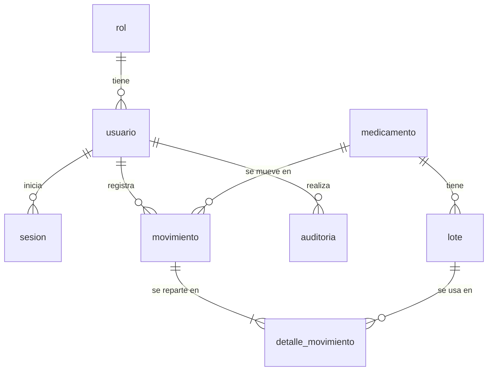

# Base de datos — versión 2 (informe de modificaciones)

MySQL 8, base `etbotfarma`, **8 tablas** (se conservan todas, con sus nombres).
El backend la usa con **SQL a mano** (MySqlConnector), **sin Entity Framework ni otro ORM**.

| Archivo | Uso |
|---------|-----|
| `database/etbotfarma_mysql_v2.sql` | Crear la base desde cero (versión actual) |
| `database/migracion_v1_a_v2.sql` | Actualizar una base existente sin perder datos (una vez) |
| `database/migracion_correo_usuario.sql` | Agregar `usuario.correo` a una base que ya estaba en la versión 2 (una vez) |
| `database/etbotfarma_mysql.sql` | Versión 1 original (no se modificó) |
| `database/pruebas/pruebas_v2.sql`, `reglas_que_deben_fallar_v2.sh`, `verificar_migracion.sql` | Pruebas |

## 1. Problemas encontrados en la versión 1

| # | Tabla | Problema | Gravedad |
|---|-------|----------|----------|
| 1 | `detalle_movimiento` | Nada impedía usar un **lote de otro medicamento** en un movimiento | Alta (inconsistencia de inventario) |
| 2 | `movimiento` | `tipo` aceptaba cualquier texto (no solo ENTRADA, SALIDA, BAJA) | Media |
| 3 | `movimiento` | Una BAJA podía guardarse sin motivo | Media |
| 4 | `movimiento`, `auditoria` | Fecha y hora en dos columnas: consultas por rango más difíciles | Baja |
| 5 | `movimiento`, `auditoria` | Faltaban índices para consultar por medicamento, usuario y tipo | Baja (rendimiento) |
| 6 | `sesion` | `cerrada` repetía lo que ya dice `fecha_cierre` (podían contradecirse) | Baja |
| 7 | `sesion` | No había `fecha_expiracion`: el vencimiento solo se conocía en el código | Baja |
| 8 | `sesion` | La columna se llamaba `token` aunque guarda el **hash** (confuso) | Baja |
| 9 | `lote` | Sin índice combinado para buscar lotes en orden FEFO | Baja (rendimiento) |
| 10 | `detalle_movimiento` | El mismo lote podía repetirse en un movimiento | Baja |

Lo que **ya estaba bien** y se conserva: stock por lote con `CHECK (stock >= 0)`, cantidades `> 0`,
`stock_minimo >= 0`, unicidad de usuario, medicamento y lote, contraseñas con hash, `ON DELETE RESTRICT`
(nada se borra físicamente), roles iniciales.

## 2. Cambios realizados

| Tabla | Columnas | Restricciones | Índices |
|-------|----------|---------------|---------|
| `rol` | — | — | — |
| `usuario` | **+ `correo VARCHAR(100) NOT NULL`** (HU-03) | **`UNIQUE (correo)`** | `idx_usuario_rol (id_rol)` (nombre explícito) |
| `sesion` | `token` → **`token_hash CHAR(64)`** · **+ `fecha_expiracion DATETIME`** · **− `cerrada`** | `CHECK (fecha_expiracion > fecha_inicio)` · `CHECK (fecha_cierre IS NULL OR fecha_cierre >= fecha_inicio)` | `idx_sesion_usuario` |
| `medicamento` | — (se conserva la unicidad nombre + sustancia + presentación + concentración) | — | — |
| `lote` | — | **`UNIQUE (id_lote, id_medicamento)`** (para validar el detalle) | **`idx_lote_fefo (id_medicamento, fecha_caducidad, fecha_entrada)`** |
| `movimiento` | `fecha DATE` + `hora TIME` → **`fecha DATETIME`** | **`CHECK (tipo IN ('ENTRADA','SALIDA','BAJA'))`** · **`CHECK` BAJA con motivo** · `UNIQUE (id_movimiento, id_medicamento)` | `(fecha)`, `(tipo, fecha)`, `(id_medicamento, fecha)`, `(id_usuario, fecha)` |
| `detalle_movimiento` | **+ `id_medicamento`** | **FK `(id_movimiento, id_medicamento)` → movimiento** · **FK `(id_lote, id_medicamento)` → lote** · `UNIQUE (id_movimiento, id_lote)` | `(id_lote, id_medicamento)` |
| `auditoria` | `fecha DATE` + `hora TIME` → **`fecha DATETIME`** | — | `(fecha)`, `(tabla_afectada, id_registro)`, `(id_usuario, fecha)` |

### ¿Cómo se garantiza que el lote es del mismo medicamento?

`detalle_movimiento` guarda `id_medicamento` y tiene **dos llaves foráneas compuestas**:

```
(id_movimiento, id_medicamento) → movimiento(id_movimiento, id_medicamento)   el medicamento ES el del movimiento
(id_lote,       id_medicamento) → lote(id_lote, id_medicamento)               el lote ES de ese medicamento
```

Si alguien intenta guardar un lote de otro medicamento, MySQL lo rechaza (probado en `reglas_que_deben_fallar_v2.sh`).

### Lo que garantiza el backend (no la base de datos)

- **Suma de detalles = `cantidad_total`**: el handler arma el movimiento y sus detalles juntos (regla en Domain) y todo se guarda en una transacción.
- **No descontar más de lo disponible**: `UPDATE lote SET stock = stock - @c WHERE id_lote = @id AND stock >= @c`; si afecta 0 filas → error y ROLLBACK. Además el `CHECK (stock >= 0)` lo impide de último recurso.
- **FEFO** (HU-13): consulta `ORDER BY fecha_caducidad, fecha_entrada` solo con lotes con stock y no caducados.
- **Transacciones**: `ConexionMySql` abre una transacción por petición; `GuardarCambiosAsync` hace COMMIT; si hay un error, ROLLBACK.

## 3. Diagrama de relaciones



| Relación | Cardinalidad | Llave foránea | Al borrar |
|----------|--------------|---------------|-----------|
| rol → usuario | 1 a muchos | `usuario.id_rol` → `rol.id_rol` | RESTRICT (no se borra un rol con usuarios) |
| usuario → sesion | 1 a muchos | `sesion.id_usuario` → `usuario.id_usuario` | RESTRICT |
| usuario → movimiento | 1 a muchos | `movimiento.id_usuario` → `usuario.id_usuario` | RESTRICT |
| usuario → auditoria | 1 a muchos | `auditoria.id_usuario` → `usuario.id_usuario` | RESTRICT |
| medicamento → lote | 1 a muchos | `lote.id_medicamento` → `medicamento.id_medicamento` | RESTRICT |
| medicamento → movimiento | 1 a muchos | `movimiento.id_medicamento` → `medicamento.id_medicamento` | RESTRICT |
| movimiento → detalle_movimiento | 1 a 1 o más | `(id_movimiento, id_medicamento)` → `movimiento` | RESTRICT |
| lote → detalle_movimiento | 1 a muchos | `(id_lote, id_medicamento)` → `lote` | RESTRICT |

`auditoria.tabla_afectada` + `id_registro` señalan el registro cambiado de cualquier tabla (usuarios, medicamentos, lotes, movimientos): no es llave foránea porque puede apuntar a varias tablas.

## 4. Cambios en el backend (ya hechos)

| Archivo | Cambio |
|---------|--------|
| `Infrastructure.csproj` | Se quitó Pomelo / EF Core; queda **MySqlConnector 2.6.2** |
| `Persistence/EtbotFarmaDbContext.cs`, `Persistence/Configuraciones/*` | **Eliminados** |
| `Persistence/ConexionMySql.cs` | **Nuevo**: conexión + transacción por petición; implementa `IUnitOfWork` (COMMIT / ROLLBACK) |
| `Persistence/Repositorios/UsuarioRepository.cs`, `SesionRepository.cs` | SQL a mano con parámetros (`token_hash`, `fecha_expiracion`, `fecha_cierre`) |
| `Persistence/InicializadorBaseDatos.cs` | Crea el administrador con `INSERT` |
| `Domain/Entities/Sesion.cs` | `TokenHash`, `FechaExpiracion`; `Cerrada` se calcula con `FechaCierre`; `Reconstruir(...)` |
| `Domain/Entities/Usuario.cs` | `Reconstruir(...)` para armarlo desde MySQL |
| `Application/.../ISesionRepository.cs` | + `ActualizarAsync` (sin EF no hay seguimiento automático de cambios) |
| Handlers `IniciarSesion` / `ValidarSesion` | Usan la duración configurada para la expiración y llaman a `ActualizarAsync` |

**Frontend: sin cambios.** Las rutas y el JSON de la API son los mismos.

## 5. Pruebas SQL (`database/pruebas/pruebas_v2.sql`)

| # | Qué comprueba |
|---|---------------|
| 1 | Registro de usuarios con rol; sesión guardada con hash y expiración |
| 2 | Registro de medicamentos |
| 3 | Registro de lotes (uno que caduca antes pero entró después, uno caducado) |
| 4 | Entrada de inventario: lote + movimiento + detalle en una transacción |
| 5 | Salida **FEFO**: el orden toma primero el lote que caduca antes y nunca el caducado; los detalles suman la cantidad |
| 6 | Baja con motivo |
| 7 | Existencias vigentes, SIN EXISTENCIAS y stock mínimo |
| 8 | Lotes próximos a caducar (3 meses o menos) |
| 9 | Auditoría con usuario, tabla y valores, sin contraseñas ni tokens |
| 10 | Una salida mayor al stock no descuenta nada y el ROLLBACK no deja el movimiento a medias |

`reglas_que_deben_fallar_v2.sh` comprueba 21 rechazos: stock negativo, descontar de más, cantidad 0 o negativa,
tipo inválido, baja sin motivo, lote de otro medicamento, duplicados, borrar registros con historial, sesión mal fechada, etc.

## 6. Cambios obligatorios y mejoras opcionales

| Cambio | Tipo |
|--------|------|
| Lote del mismo medicamento en el detalle | **Obligatorio** (integridad) |
| Tipos de movimiento restringidos, baja con motivo | **Obligatorio** (integridad) |
| Fecha y hora en un DATETIME | Pedido por el equipo |
| `fecha_expiracion`, quitar `cerrada`, `token_hash` | Pedido por el equipo |
| Índices nuevos | Mejora (rendimiento) |

## Correo electrónico del usuario (HU-03)

Decisión del equipo: el **correo** identifica a cada persona y evita registrarla dos veces.

| Columna | ¿Se repite? | Para qué |
|---------|-------------|----------|
| `nombre`, `apellidos` | Sí | Saber quién es (dos personas pueden llamarse igual) |
| `nombre_usuario` | No (`UNIQUE`) | Iniciar sesión |
| `correo` | No (`UNIQUE`) | Identificar a la persona y detectar duplicados |
| `telefono` | Sí | Solo contacto |

- El backend guarda el correo en minúsculas y sin espacios (`Usuario.NormalizarCorreo`), y la intercalación
  `utf8mb4_spanish2_ci` tampoco distingue mayúsculas: `Ana@Gmail.com` y `ana@gmail.com` son el mismo correo.
- **Base nueva**: `etbotfarma_mysql_v2.sql` ya trae la columna.
- **Base que ya tenías en la versión 2**: ejecuta una vez `mysql -u root -p < database/migracion_correo_usuario.sql`
  (en Codespaces lo hace solo `preparar.sh`). Los usuarios que ya existían reciben un correo provisional
  `nombre_usuario@pendiente.etbotfarma`; cámbialo por el real.
- El administrador inicial toma su correo de `AdministradorInicial:Correo` (`appsettings.json`).

## Auditoría de cambios administrativos (compartida)

Se usa la tabla `auditoria` tal como está (no se agregaron columnas).

| Pieza | Dónde | Para qué |
|-------|-------|----------|
| `Auditoria` (entidad) | `Domain/Entities/Auditoria.cs` | Arma el registro y revisa que tenga quién, acción, tabla y registro. Constantes de acciones (`CREAR USUARIO`) y tablas |
| `IAuditoriaRepository` | `Application/Common/Interfaces/Repositorios/` | Lo que usan los handlers |
| `AuditoriaRepository` | `Infrastructure/Persistence/Repositorios/` | El `INSERT` parametrizado |

- **Quién**: `IUsuarioActual.IdUsuario` (lo deja la cookie de sesión). Nunca un id fijo.
- **Misma transacción**: el handler guarda el cambio, después la auditoría y al final llama UNA vez a
  `GuardarCambiosAsync` (COMMIT). Si algo falla, no se guarda ninguno de los dos.
- **Sin datos sensibles**: `valor_nuevo` / `valor_anterior` son JSON sin contraseña, hash, token ni teléfono
  (`Usuario.DatosParaAuditoria()`).
- **Limitación**: la tabla no tiene columna de *resultado*. Por la transacción, solo existen registros de operaciones
  que SÍ se hicieron; los intentos rechazados (correo repetido, sin permiso) no dejan registro.
- **Reutilizar** (HU-05, desactivar usuario, editar medicamento...): agrega la constante de la acción en `Auditoria`,
  inyecta `IAuditoriaRepository` + `IUsuarioActual` en tu handler y llama a
  `Auditoria.Crear(idUsuario, accion, tabla, idRegistro, valorAnterior, valorNuevo, fecha)` antes del COMMIT.

